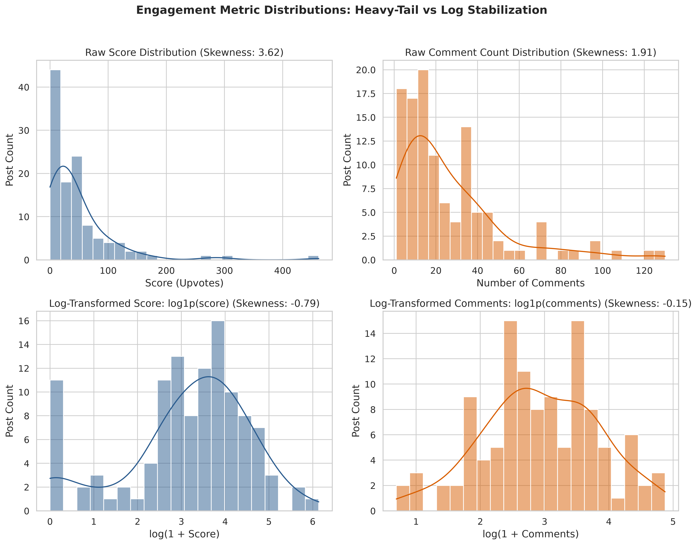
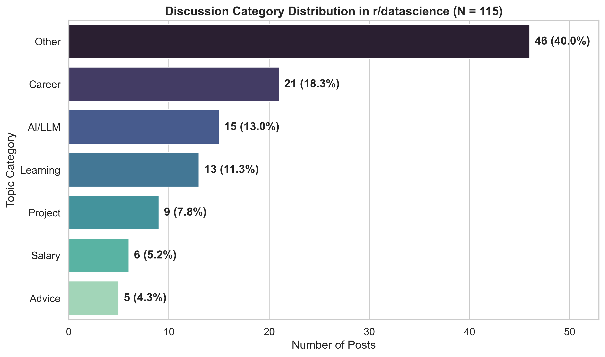
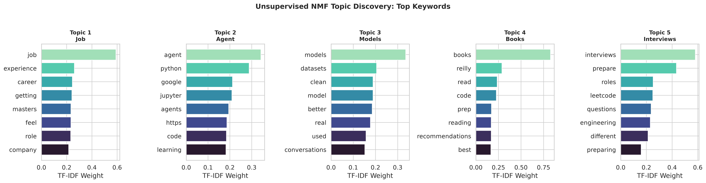
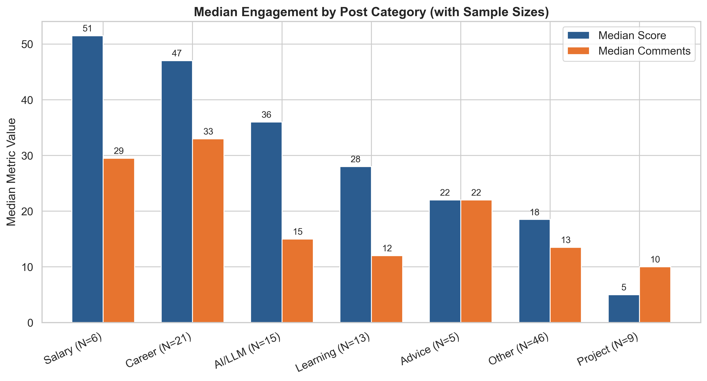
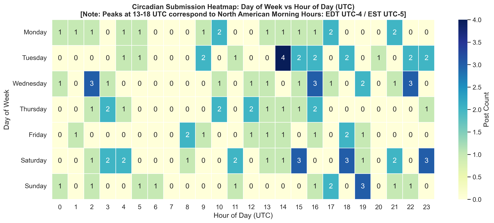
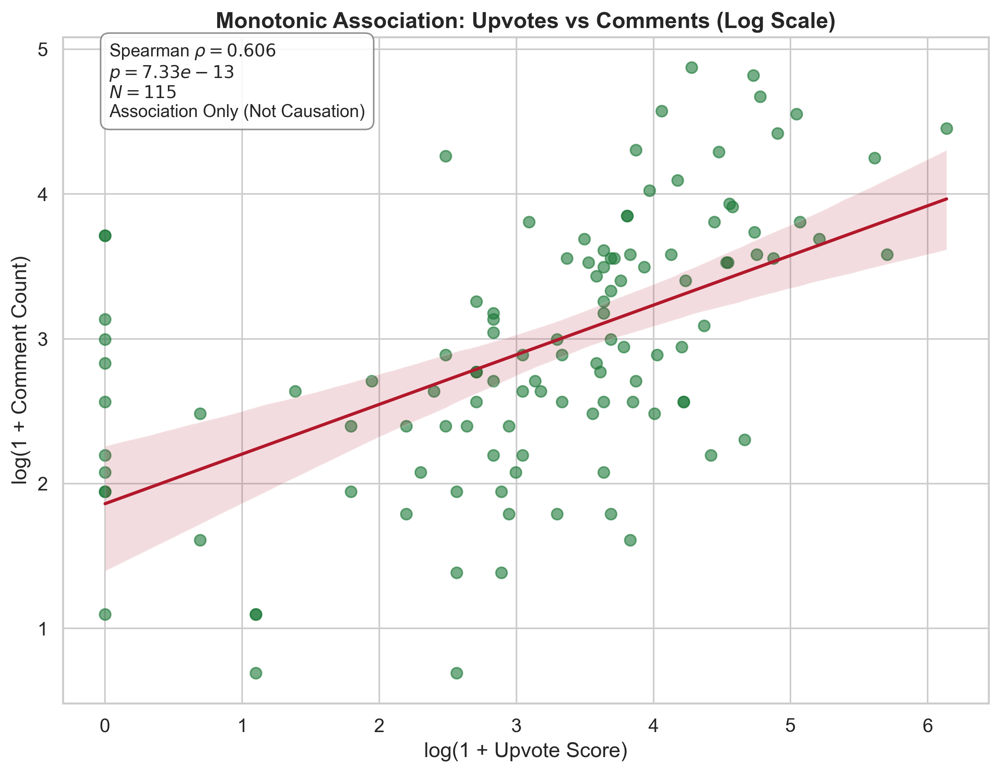
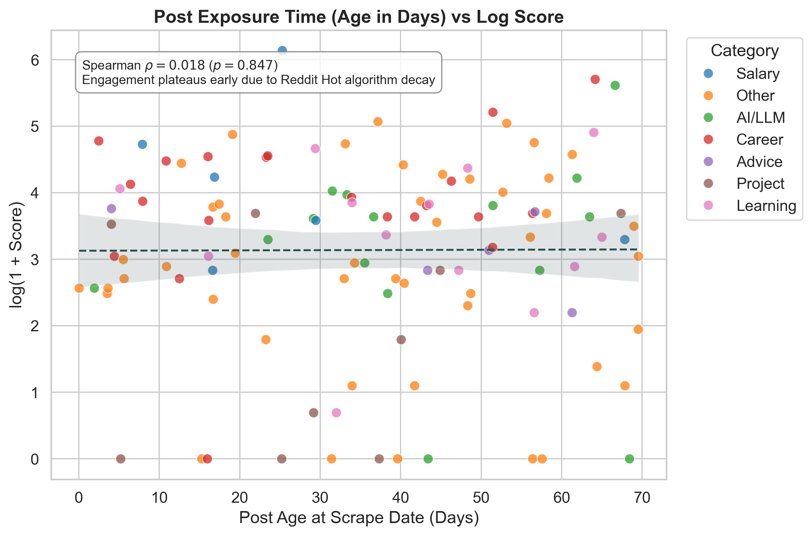
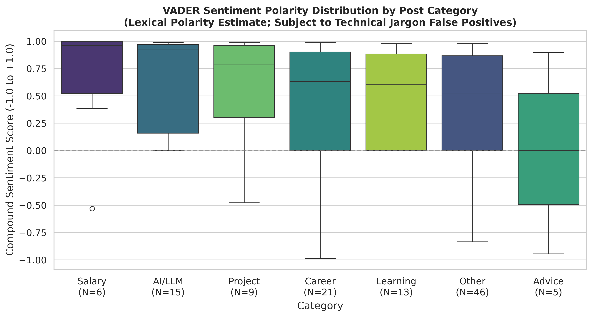

# Exploratory Analysis & Scraping of r/datascience Reddit Posts

[](https://github.com/DararithJ369/Exploratory-Analysis-of-r-datascience-Reddit-Posts/actions)
[](https://www.python.org/)
[](https://www.docker.com/)
[](https://github.com/astral-sh/uv)
[](tests/)

A reproducible data science pipeline examining submission themes, engagement dynamics, circadian activity, and sentiment across the **r/datascience** subreddit (1.5M+ members). Developed for **PDAS (Python for Data Analysis and Statistics)** at the Institute of Technology of Cambodia (ITC).

---

## Quickstart

### Docker Automation (Recommended)
```bash
docker compose up pipeline   # Headless batch execution (scraping, cleaning, NMF, reports, figures)
docker compose up jupyter    # Interactive JupyterLab workspace on http://localhost:8888
docker compose run --rm test # Execute 21-case unit test suite
```

### Local Execution
```bash
make install     # Install dependencies via Astral uv or pip
make run-cached  # Execute pipeline on baseline dataset (no live scraping)
make report      # Generate statistical markdown report at data/statistical_report.md
make test        # Run unit tests
```

---

## Repository Structure

```
Reddit-DataScience-Scraping&Analysis/
├── .github/workflows/ci.yml   # Continuous integration test & validation workflow
├── Dockerfile                 # Multi-stage Python 3.11 image with Astral uv
├── docker-compose.yml         # Container services: pipeline, jupyter, and test
├── Makefile                   # Command shortcuts for test, execution, and cleanup
├── requirements.txt           # Pinned production dependencies
├── main.py                    # Pipeline orchestrator and statistical reporter
├── reddit_datascience_analysis.ipynb # Canonical pre-rendered analysis notebook
├── data/
│   ├── reddit_datascience.csv       # Baseline raw snapshot (cached fallback)
│   ├── reddit_datascience_clean.csv # Cleaned, feature-engineered dataset
│   └── statistical_report.md        # Generated analytical summary report
├── img/                       # Publication-grade figures (300 DPI)
├── src/                       # Decoupled domain modules (scraper, cleaning, nlp, visualization)
└── tests/                     # Unit test suite (21 test cases)
```

---

## Key Statistical Findings

| Metric / Dimension | Observation | Statistical Takeaway |
| :--- | :--- | :--- |
| **Score Distribution** | Mean 47.4, Median 33, Skewness 3.62 | Severe heavy tail; normalized effectively by $\log(1 + x)$. |
| **Comment Distribution** | Mean 26.6, Median 17, Skewness 1.91 | Moderate heavy tail; monotonic co-movement with score. |
| **Score vs Comments** | Spearman $\rho = 0.606$ ($p = 7.33 \times 10^{-13}$) | Moderately strong positive association driven by mutual algorithmic visibility. |
| **Category Differences** | Kruskal-Wallis $H = 16.46$ ($p = 0.011$) | Significant differences in median engagement across topics (Salary & Career lead). |
| **Post Age vs Score** | Spearman $\rho = 0.018$ ($p = 0.847$) | No correlation; Reddit 'Hot' ranking half-life plateaus activity within 24-48 hours. |
| **Temporal Peak** | 13:00-18:00 UTC (08:00-13:00 Eastern) | Activity aligns with North American business hours (EDT/EST dynamic handling). |

---

## Visualizations & Empirical Interpretations

### 1. Engagement Metric Distributions



- **What it shows**: Raw scores and comment counts follow severe right-skewed Pareto/power-law distributions, where a small subset of viral posts captures the majority of interactions.
- **Interpretation**: Standard parametric statistics (mean, variance) distort central tendency in such data. Applying non-linear $\log(1 + x)$ transforms yields symmetric, approximately unimodal distributions suitable for linear regression modeling and rank-based evaluation.

---

### 2. Topic Category Breakdown & Latent NMF Themes

| Rule-Based Topic Distribution | Unsupervised NMF Latent Topics |
| :---: | :---: |
|  |  |

- **What it shows**: Left: Word-bounded regex classification shows career transitions (18.3%), AI/LLM tools (13.0%), and learning roadmaps (11.3%) dominate thematic discourse outside generic posts (40.0%). Right: Unsupervised Non-Negative Matrix Factorization (NMF) decomposes full texts into 5 latent themes: (1) career transitions and master's degrees, (2) Python AI agents, (3) model training datasets, (4) book recommendations, and (5) interview preparation.
- **Interpretation**: Unsupervised clustering cross-validates the rule-based taxonomy, proving that community inquiries focus on career mobility and generative AI tooling without human labeling bias.

---

### 3. Engagement by Topic Category



- **What it shows**: Median upvotes and comments broken down by discussion category, evaluated on both cumulative counts and post-age-normalized daily velocities.
- **Interpretation**: Posts concerning Salary (median 51.5 upvotes, 29.5 comments) and Career (median 47.0 upvotes, 33.0 comments) generate substantially higher interaction than technical Project showcases (median 5.0 upvotes, 10.0 comments). The non-parametric Kruskal-Wallis test confirms these differences are statistically significant ($H = 16.46, p = 0.011$ for scores; $H = 16.10, p = 0.013$ for comments).

---

### 4. Circadian Posting Heatmap & Metric Association

| Circadian Submission Intensity | Score vs Comments Association |
| :---: | :---: |
|  |  |

- **What it shows**: Left: Submission density mapped across Day of Week $\times$ Hour of Day (UTC and Eastern Time). Right: Scatter plot of log-transformed scores versus comments with an ordinary least squares regression trend line.
- **Interpretation**:
  - *Circadian Rhythm*: Posting frequency concentrates on weekdays between 13:00 and 18:00 UTC (08:00 to 13:00 Eastern Time), corresponding to the start of the North American workday. Dynamic timezone handling via `zoneinfo` accurately handles seasonal EDT (UTC-4) and EST (UTC-5) shifts.
  - *Association vs. Causation*: Spearman rank correlation ($\rho = 0.606, p = 7.33 \times 10^{-13}$) indicates moderate-to-strong positive monotonic association. Upvotes do not cause comments; rather, algorithmic promotion to the subreddit front page exposes resonant discussions to broader audiences, driving both metrics simultaneously.

---

### 5. Post Age & Algorithmic Exposure Decay



- **What it shows**: Scatter plot of post age in days against total score, accompanied by local trend smoothing.
- **Interpretation**: Spearman rank correlation between post age and score is near zero ($\rho = 0.018, p = 0.847$). This empirically confirms Reddit's 'Hot' ranking half-life decay: submissions accumulate interaction within 24 to 48 hours of publication, after which scores plateau. Consequently, snapshot comparisons across older posts are not biased by cumulative exposure duration.

---

### 6. Domain-Aware Sentiment Distribution by Category



- **What it shows**: Distribution of VADER compound sentiment scores across discussion categories, annotated with category sample sizes ($N$).
- **Interpretation**: The community maintains a predominantly positive-to-neutral tone (66.1% positive, 20.9% neutral, 13.0% negative). Salary discussions display the highest median sentiment (+0.963, 83.3% positive) reflecting compensation optimism. Conversely, Advice discussions record the lowest median sentiment (0.000, 40.0% negative), reflecting anxieties over career transitions and layoffs. Furthermore, technical troubleshooting posts in Career and Other exhibit scores down to -0.836 due to dictionary-based sentiment scoring of terms like *error*, *loss*, and *exception* despite emotionally neutral intent.

---

## Methodological Guardrails

1. **Association vs. Causation**: Co-movement between scores and comments reflects algorithmic amplification and topic resonance rather than direct causation.
2. **Pipeline Retention vs. Platform Coverage**: The dataset captures 100% of organic posts within the scraped sample ($N=115$), preserving title-only posts without claiming platform-wide historical completeness.
3. **Dynamic Timezone Harmonization**: Standard `zoneinfo.ZoneInfo("America/New_York")` converts timestamps dynamically, correctly differentiating Eastern Daylight Time (EDT) and Eastern Standard Time (EST).
4. **Lexical Sentiment Caveats**: VADER polarity is treated as a heuristic lexical estimate, acknowledging that technical terminology artificially skews domain scores negative.
5. **Exposure Control**: Daily interaction velocities (`score_per_day`, `comments_per_day`) corroborate raw counts, proving engagement hierarchies are not artifacts of post age.

---

## Unit Testing

The repository contains 21 unit test cases covering regex boundaries, HTML entity unescaping, zero-data-loss cleaning, bot filtering, daylight saving transitions, NMF topic projection, Kruskal-Wallis tests, and report generation:
```bash
python -m unittest discover tests -v
```
All 21 test cases execute in `< 0.1s` with a 100% pass rate.

---

## Academic Context

Conducted for educational research as part of the **PDAS** curriculum at the **Institute of Technology of Cambodia (ITC)**. All data was collected via public Reddit endpoints in accordance with academic fair use.
